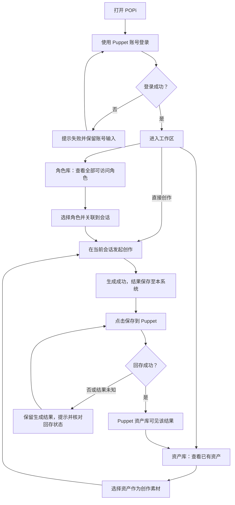
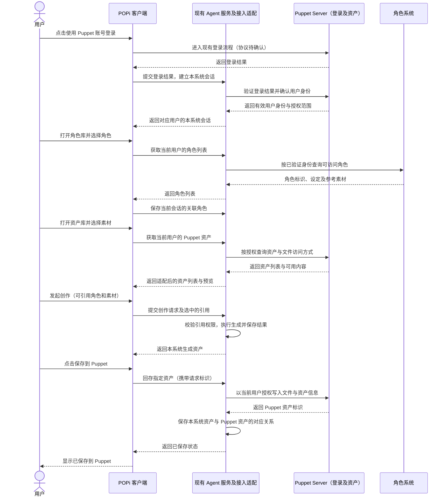

# Puppet Server 登录、角色与资产接入最小方案

> 日期：2026-10-25。状态：需求整理与方案草案，尚未实施或联调 Puppet Server。

## 1. 一句话说明

用户使用 Puppet Server 的账号登录 POPi，查看自己的角色和已有资产，将角色关联到会话、将资产用于创作，再把本系统生成的资产保存回 Puppet Server。

## 2. 首期范围

| 能力 | 最简单的使用方式 |
| --- | --- |
| 登录 | 复用 Puppet Server 的登录体系，登录后获得对应用户身份，无需另建一套账号。 |
| 查看与关联角色 | 展示当前用户有权访问的全部角色；在会话中选择关联角色，供后续创作使用。角色库分页展示，单会话关联数量沿用现有上限 5 个。 |
| 使用已有资产 | 在资产库查看 Puppet Server 中当前用户有权访问的资产，选择后带入当前创作。首期支持哪些文件类型，以双方接口能力为准。 |
| 回存生成资产 | 生成结果先保存在本系统；用户点击“保存到 Puppet”后，回存至该用户的 Puppet 资产库，之后可再次选用。 |

首期建议采用用户主动回存，暂不增加自动双向同步、批量历史迁移或跨系统编辑、删除同步。

本文将“角色系统”和“Puppet Server”画成两个逻辑服务；若角色接口也由 Puppet 提供，可合并为同一个服务。这里的角色指内容角色，不是执行任务的 Popi 助手成员。

## 3. 用户流程图

角色和已有资产均按需选择，不要求每次创作同时选择两者。查看全部角色与关联到当前会话是两个动作，打开角色库不会自动关联。

## 4. 系统交互图（时序图）

以下是建议的逻辑交互，不代表 Puppet 已提供对应接口。登录授权、凭据交换与校验步骤需按 Puppet 实际协议调整；角色和资产由现有服务端适配后提供给客户端。

## 5. 页面交互与最小约定

| 页面或入口 | 用户操作 | 页面结果 |
| --- | --- | --- |
| 登录页 | 使用 Puppet 账号登录 | 成功后进入工作区；失败提示并保留非敏感输入。 |
| 会话的角色选择入口 | 查看、选择、确认 | 显示已关联角色；带入角色设定及可用参考素材。 |
| 资产库／创作素材选择入口 | 浏览、预览、选择 | 将所选资产加入创作草稿，发送时提交引用。 |
| 生成结果卡片 | 点击“保存到 Puppet” | 处理中使用 loading 图标；成功后显示“已保存到 Puppet”。 |
| 回存失败或结果未知 | 再次点击原“保存到 Puppet”操作 | 保留本系统结果；服务端核对原请求状态，避免重复入库。 |

最少需要约定四件事：

1. **同一用户**：以 Puppet 的稳定用户标识建立身份对应；角色、资产、会话与回存都按该身份检查权限。现有共享测试门禁不能直接视为 Puppet 用户身份。
2. **稳定引用**：保存来源系统及原始角色／资产标识；回存成功后记录两侧资产标识的对应关系，不用名称或临时文件链接作为唯一标识。
3. **可用文件**：选中角色或素材后，服务端须能读取实际设定与文件，并交给生成链路使用；仅展示头像、文件名或缩略图不算完成接入。
4. **独立回存状态**：本系统生成成功与 Puppet 回存成功分别记录；同一用户、同一生成资产重复回存应复用结果，回存失败不丢失生成资产。

## 6. 现有基础与后续待核对信息

当前仓库已有可复用入口：

- [Harness 登录](../lib/features/demo/data/harness_access_repository.dart)：现有测试服务登录，尚非 Puppet 登录。
- [会话角色选择](../lib/features/demo/presentation/demo_settings_page.dart)：已有角色关联交互，目前列表使用样例角色与会话自定义角色，尚非 Puppet／角色系统列表。
- [会话与生成 Repository](../lib/features/demo/data/demo_repository.dart)：已有角色配置、素材引用和生成资产恢复路径。
- [Agent 资产 API](../lib/core/network/network_agent_api.dart)：已有资产列表、上传与受保护文件读取；当前媒体路径限制为配置中的 Agent 同源，不能直接填入任意 Puppet 文件 URL。
- [测试服务器说明](../deploy/harness/README.md)：当前为共享测试环境；按用户隔离数据是接入真实账号时必须补齐的能力。

后续实施前需从 Puppet Server／角色系统核对：

| 待核对项 | 需要拿到的信息 |
| --- | --- |
| 服务位置 | 测试服务器上的 Puppet 地址、角色服务地址，以及两者是否为同一服务。 |
| 登录 | 现有登录入口、授权／会话协议、稳定用户标识、有效期及退出方式。 |
| 角色 | 列表与详情接口、用户关联关系、分页方式、角色设定和参考素材字段。 |
| 资产 | 列表与文件读取接口、支持类型、访问授权，以及生成服务获取原文件的方式。 |
| 回存 | 文件上传及资产登记方式、归属字段、写入权限、重复提交及结果查询机制。 |

本次仅核对当前仓库，未连接 Puppet Server；以上外部接口信息均未确认。

**后续最小验收闭环：**用一个 Puppet 账号登录 → 查看自己的角色 → 关联一个角色 → 选用一个已有资产 → 生成一个结果 → 保存到 Puppet → 在 Puppet 和 POPi 中均能重新看到并选用。另验证无权限数据不可见、回存失败不丢结果、重复提交不重复入库。
